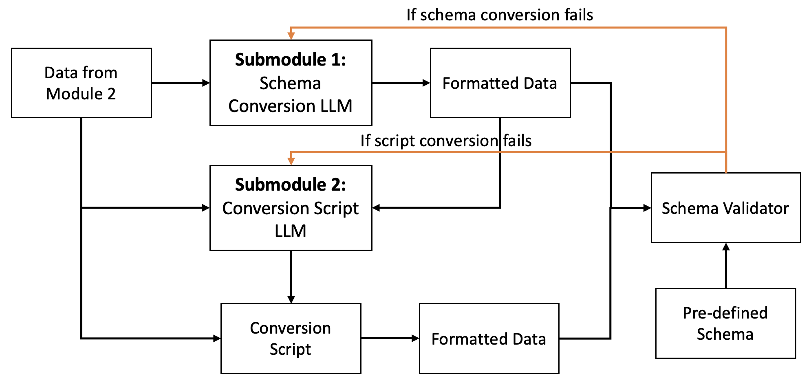

# FusionFly: Un marco de trabajo escalable y de código abierto para la estandarización de datos de posicionamiento impulsada por IA


[](https://github.com/Thorkee/FusionFly/wiki)


FusionFly es un kit de herramientas de código abierto para el procesamiento y fusión de datos de GNSS (Sistema Global de Navegación por Satélite) e IMU (Unidad de Medición Inercial) con Optimización de Grafos de Factores (FGO). El sistema proporciona una interfaz web moderna para cargar, procesar, visualizar y descargar datos de navegación estandarizados.           

## Demostración

Vea el video de demostración de FusionFly para observar el sistema en acción:

[](https://youtu.be/oGyyChs1mSo)

También puede:
- [Descargar el video de demostración](./public/assets/FusionFly%20Demo.mov) directamente desde el repositorio

*Nota: Después de clonar el repositorio, podrá encontrar el video de demostración en el directorio public/assets.*

## Arquitectura del Sistema

FusionFly sigue una arquitectura cliente-servidor estándar con un frontend en React, un backend en Express.js y una cola de trabajos en Redis para el procesamiento de archivos grandes.


                            
```
┌─────────────────┐          ┌─────────────────┐          ┌─────────────────┐
│                 │          │                 │          │                 │
│  React Frontend │◄────────►│  Express Backend│◄────────►│   Redis Queue   │
│                 │   HTTP   │                 │   Jobs   │                 │
└────────┬────────┘          └────────┬────────┘          └────────┬────────┘
         │                            │                            │
         │                            │                            │
         ▼                            ▼                            ▼
┌─────────────────┐          ┌─────────────────┐          ┌─────────────────┐
│  User Interface │          │  File Storage   │          │  Data Processing│
│  - File Upload  │          │  - Raw Files    │          │  - Conversion   │
│  - Visualization│          │  - Processed    │          │  - FGO          │
│  - Downloads    │          │  - Results      │          │  - Validation   │
└─────────────────┘          └─────────────────┘          └─────────────────┘
```

## Canalización de Estandarización de Datos

FusionFly procesa los datos a través de una canalización de estandarización:

```
┌───────────┐     ┌────────────┐     ┌───────────────┐     ┌───────────┐     ┌──────────────┐     ┌─────────────┐
│           │     │            │     │               │     │           │     │              │     │             │
│  Detect   │────►│ Process via│────►│ AI-Assisted   │────►│ Conversion│────►│ Schema       │────►│ Schema      │
│  Format   │     │ Standard   │     │ Parsing       │     │ Validation│     │ Conversion   │     │ Validation  │
│           │     │ Script     │     │ (if needed)   │     │           │     │              │     │             │
└───────────┘     └────────────┘     └───────────────┘     └───────────┘     └──────────────┘     └─────────────┘
                         │                   │                   │                   │                   │
                         │                   │                   │                   │                   │
                         ▼                   ▼                   ▼                   ▼                   ▼
                  ┌────────────────────────────────────────────────────────────────────────────────────────┐
                  │                                                                                        │
                  │                           Automated Feedback Loop                                      │
                  │                                                                                        │
                  └────────────────────────────────────────────────────────────────────────────────────────┘
```

1. **Detección de formato**
   - Analiza la extensión y el contenido del archivo para determinar el formato de los datos
   - Identifica la ruta de procesamiento adecuada

2. **Intento con script estándar**:
   - **RINEX (archivos .obs)**
     - Procesa utilizando la biblioteca georinex
     - Convierte a un formato estandarizado con marcas de tiempo
     - Utiliza análisis asistido por IA si la conversión estándar falla
   - **NMEA (archivos .nmea)**
     - Procesa sentencias NMEA usando pynmea2
     - Maneja tipos de mensajes comunes (GGA, RMC)
     - Extrae marcas de tiempo y coordenadas
     - Utiliza análisis asistido por IA cuando sea necesario
   - **Formatos desconocidos**
     - Analiza el contenido del archivo para determinar la estructura
     - Genera la lógica de conversión adecuada
     - Extrae datos de ubicación relevantes

3. **Análisis asistido por IA**
   - Si el script estándar no funciona, llamará al servicio Azure OpenAI con un fragmento de datos
   - Ejecuta automáticamente el código de conversión generado en el backend
   - Proporciona información detallada de errores para mejorar los intentos posteriores

### Características de Robustez del LLM

FusionFly implementa mecanismos robustos de validación y respaldo para cada paso del LLM en la canalización de conversión asistida por IA:

#### Conversión de formato (Primer LLM)
- **Generación de script**: El LLM genera un script completo de Node.js para procesar el archivo de entrada
- **Validación**: El sistema ejecuta el script generado y valida que la salida se ajuste al formato JSONL esperado
- **Mecanismo de respaldo**: 
  - Cuando el script falla al ejecutarse o produce una salida inválida, el sistema captura errores específicos
  - Los detalles del error se retroalimentan al LLM en un formato estructurado para mejorar el reintento
  - Se instruye al LLM para corregir problemas específicos en su siguiente intento de generación de script
  - El sistema realiza hasta 3 intentos con retroalimentación de errores cada vez más detallada

#### Extracción de ubicación (Segundo LLM)
- **Generación de script**: El LLM genera un script especializado de Node.js para extraer datos de ubicación de la salida de la primera etapa
- **Validación**: El sistema ejecuta el script y valida las coordenadas (latitud/longitud en rangos correctos), marcas de tiempo y la presencia de campos requeridos
- **Mecanismo de respaldo**:
  - Detecta errores de ejecución del script o datos de ubicación faltantes/inválidos en la salida de extracción
  - Proporciona orientación específica de campo al LLM sobre problemas de conversión
  - Incluye ejemplos de formato correcto en la retroalimentación de errores
  - Reintenta con un patrón de aprendizaje por refuerzo progresivo

#### Conversión de esquema (Tercer LLM) - Enfoque mejorado de dos submódulos
- **Submódulo 1: Conversión directa de esquema**
  - Toma una pequeña muestra de datos del Módulo 2 (datos de ubicación)
  - Lo convierte directamente al formato del esquema objetivo sin generar código
  - Valida la muestra convertida contra los requisitos del esquema
  - Produce un conjunto de ejemplos de alta calidad para guiar al segundo submódulo
  - El prompt se centra en la transformación directa de datos, no en la generación de código

- **Submódulo 2: Generación de script de transformación**
  - Toma tanto los datos en bruto como los ejemplos convertidos del Submódulo 1
  - Genera un script de transformación de Node.js basado en el patrón mostrado en los ejemplos
  - El script se ejecuta para procesar todo el conjunto de datos
  - La salida se valida contra los requisitos del esquema
  - El prompt incluye tanto los datos de entrada como ejemplos correctamente formateados para la coincidencia de patrones

- **Flujo mejorado de validación y retroalimentación**:
  - Si el Submódulo 1 falla, todo el proceso falla (ya que se requieren ejemplos para el Submódulo 2)
  - Los mensajes de error detallados identifican problemas específicos de incumplimiento del esquema
  - La salida de ambos submódulos se valida contra el esquema objetivo
  - Reintenta con instrucciones mejoradas basadas en fallos específicos de validación

### Arquitectura de la Canalización del Tercer LLM

La arquitectura detallada del tercer módulo LLM mejorado se ilustra a continuación:



Este diagrama muestra cómo el sistema primero intenta una conversión directa del esquema con el Submódulo 1, y luego utiliza tanto los datos originales como los ejemplos convertidos para generar un script de transformación con el Submódulo 2. El script se ejecuta a continuación para procesar todo el conjunto de datos, con validación en cada paso para garantizar el cumplimiento del esquema predefinido.

La canalización completa de transformación de datos a través de los tres módulos se muestra aquí:


Esta vista de extremo a extremo muestra cómo cada módulo contribuye al proceso general de transformación, desde la conversión de formato hasta la extracción de ubicación y la conversión final del esquema.

#### Pruebas Unitarias
- El conjunto completo de pruebas cubre cada paso del LLM con:
  - Pruebas de caso feliz con entradas válidas y salidas esperadas
  - Pruebas de manejo de errores con entradas malformadas
  - Pruebas de casos extremos (archivos vacíos, campos faltantes, etc.)
  - Pruebas de simulación y recuperación de errores de API
  - Pruebas de mecanismos de validación y respaldo

#### Bucle de Retroalimentación de Errores
- Toda la canalización implementa un bucle cerrado de retroalimentación donde:
  - Cada paso valida la salida del paso anterior
  - Los errores de validación se capturan en detalle
  - La información estructurada de errores guía el siguiente intento del LLM
  - El sistema aprende de fallos anteriores para mejorar la calidad de conversión
  - Se mantienen registros detallados para depuración y mejora

Este enfoque de validación y respaldo multicapa garantiza un procesamiento robusto incluso con formatos de datos desafiantes o inusuales, mejorando significativamente la confiabilidad de la canalización de conversión asistida por IA.

4. **Validación de conversión**
   - Ejecuta pruebas unitarias exhaustivas en los datos convertidos
   - Valida el formato JSONL correcto y la integridad de los datos
   - Si la validación falla, alimenta los datos de error al LLM
   - Regenera los scripts de conversión hasta 10 veces hasta que se conviertan correctamente a JSONL

5. **Conversión de esquema**
   - Después de convertir a JSONL, extrae las entradas de datos al esquema objetivo
   - Utiliza el enfoque mejorado de dos submódulos:
     1. Primero convierte directamente una pequeña muestra al esquema objetivo
     2. Luego genera un script utilizando tanto los datos en bruto como los ejemplos convertidos
   - Maneja mapeos complejos de campos y transformaciones de datos
   - Aplica reglas de limpieza y normalización de datos
   - Produce una salida estructuralmente consistente que cumple con el esquema objetivo

6. **Validación de esquema**
   - Realiza una validación rigurosa contra la estructura del esquema requerida
   - Verifica específicamente que los nombres de entrada coincidan exactamente con el esquema objetivo
   - Valida tipos de datos, campos requeridos y restricciones estructurales
   - Si la validación falla, activa el mecanismo de respaldo:
     - Informa errores específicos de validación al LLM
     - Genera código de conversión mejorado con mapeos de campos corregidos
     - Reprocesa los datos con instrucciones mejoradas
     - Se repite hasta que la salida cumpla completamente con las especificaciones del esquema

Cada paso incluye un manejo exhaustivo de errores y registros, lo que permite diagnósticos detallados y una mejora continua del proceso de conversión. Toda la canalización está diseñada para manejar variaciones en los formatos de datos de entrada mientras garantiza una salida consistente y estandarizada.

## Canalización de Flujo de Datos

FusionFly procesa los datos a través de una canalización bien definida:

```
┌───────────┐     ┌───────────┐     ┌───────────┐     ┌───────────┐     ┌───────────┐
│           │     │           │     │           │     │           │     │           │
│  File     │────►│  Format   │────►│ Conversion│────►│  Process  │────►│  Output   │
│  Upload   │     │  Detection│     │ to JSONL  │     │  & Fusion │     │  Results  │
│           │     │           │     │           │     │           │     │           │
└───────────┘     └───────────┘     └───────────┘     └───────────┘     └───────────┘
       │                │                │                │                   │
       ▼                ▼                ▼                ▼                   ▼
┌─────────────────────────────────────────────────────────────────────────────────────┐
│                                                                                     │
│  Supported Input Formats                │  Output Formats                           │
│  ─────────────────────                  │  ─────────────────                        │
│  GNSS:                                  │  Standardized JSONL                       │
│  - RINEX (.obs, .rnx, .21o)             │  Location Data                            │
│  - NMEA (.nmea, .gps, .txt)             │  Trajectory Visualization                 │
│  - UBX (binary)                         │  Validation Reports                       │
│  - JSON, CSV                            │                                           │
│                                         │                                           │
│  IMU:                                   │                                           │
│  - Raw IMU data (.imu)                  │                                           │
│  - CSV, JSON, TXT                       │                                           │
│                                         │                                           │
└─────────────────────────────────────────────────────────────────────────────────────┘
```

## Descripción de Componentes

### Frontend (React)

El frontend está construido con React y proporciona una interfaz de usuario moderna para interactuar con el sistema. Incluye:
                            
1. **Página de inicio**: Descripción general del sistema y sus capacidades
2. **Interfaz de carga**: 
   - Carga de archivos con arrastrar y soltar para datos de GNSS e IMU
   - Seguimiento del progreso para cargas y procesamiento
   - Detección de formato y validación
3. **Página de archivos**: 
   - Lista de archivos procesados con metadatos
   - Opciones de descarga para datos procesados
   - Gestión de caché
4. **Visualización de resultados**: (Próximamente)
   - Visualización de trayectorias
   - Análisis de errores
   - Métricas de calidad

### Backend (Express.js)

El backend proporciona los puntos finales de la API y la lógica de procesamiento:

1. **Capa de API**:
   - API RESTful para operaciones de archivos
   - Informes de estado
   - Manejo de errores
2. **Motor de procesamiento**:
   - Detección y conversión de formatos
   - Análisis de datos GNSS (RINEX, NMEA, UBX)
   - Procesamiento de datos IMU
   - Fusión de datos con FGO (Optimización de Grafos de Factores)
3. **Gestión de almacenamiento**:
   - Almacenamiento de archivos
   - Resultados de procesamiento
   - Gestión de caché

### Cola de Trabajos (Redis/Bull)

Las tareas de procesamiento de larga duración son manejadas por una cola de trabajos respaldada por Redis:

1. **Gestión de trabajos**:
   - Creación y seguimiento de trabajos
   - Informes de progreso
   - Manejo de errores y reintentos
2. **Procesos trabajadores**:
   - Conversión de archivos
   - Procesamiento de datos
   - Generación de resultados

## Sistema de Benchmark

FusionFly incluye un sistema científico de benchmark exhaustivo para evaluar la precisión, robustez y eficiencia de los procesos de transformación de datos de navegación.

### Arquitectura del Benchmark

El sistema de benchmark está organizado de la siguiente manera:

```
benchmark/
├── raw/                # Datos de navegación brutos y sin formato
│   ├── gnss/           # Datos GNSS en varios formatos
│   └── imu/            # Datos IMU en varios formatos
├── standardized/       # Datos estandarizados (referencia real)
├── test_cases/         # Casos de prueba para benchmark
│   ├── normal/         # Escenarios de operación normal
│   └── edge_cases/     # Escenarios de datos desafiantes
├── metadata/           # Información de conjuntos de datos y esquemas
├── evaluation/         # Herramientas y métricas de evaluación
└── results/            # Resultados del benchmark
```

### Diseño de Casos de Prueba

El benchmark incluye escenarios de prueba cuidadosamente construidos:

1. **Casos de prueba normales**:
   - Entorno urbano medio con NMEA
   - Entorno urbano medio con RINEX OBS
   - Entorno de túnel (solo IMU)

2. **Casos extremos**:
   - Datos faltantes: Archivos con varios campos eliminados (5-30%)
   - Datos corruptos: Archivos con valores inválidos/extremos
   - Variaciones de formato: Orden diferente de campos, unidades, etc.

### Métricas de Evaluación Científica

#### 1. Métricas de Precisión de Campos de Datos

Estas métricas cuantifican con qué precisión los datos transformados coinciden con los valores de referencia real en todos los parámetros de navegación.

**Lógica de implementación:**
- Los puntos de los conjuntos de datos de referencia real y transformados se emparejan por marcas de tiempo
- La comparación campo por campo se realiza usando notación de punto (p. ej., `position_lla.latitude_deg`)
- Se calculan medidas estadísticas para cada campo

**Métricas principales:**
- **Error Absoluto Medio (MAE)**: Diferencia absoluta promedio entre los valores originales y transformados
  ```python
  mae = np.mean(errors)  # Simple, interpretable measure of error magnitude
  ```
- **Error Cuadrático Medio (RMSE)**: Raíz cuadrada de las diferencias cuadradas promedio
  ```python
  rmse = np.sqrt(np.mean(np.array(errors) ** 2))  # Penalizes larger errors
  ```
- **RMSE Normalizado**: RMSE normalizado por el rango de los valores originales
  ```python
  nrmse = rmse / (max(gt_values) - min(gt_values))  # Makes errors comparable across different measurement types
  ```

**Métricas de precisión especializadas:**
- Precisión de transformación de coordenadas (ECEF↔LLA)
- Precisión de conversión de marcas de tiempo (microsegundos)
- Preservación de la tasa de muestreo
- Cumplimiento estructural del esquema

#### 2. Métricas de Robustez

Estas métricas evalúan cuán bien el sistema maneja variaciones, casos extremos y entradas desafiantes.

**Lógica de implementación:**
- Los archivos de prueba contienen datos intencionalmente corruptos o desafiantes
- El sistema procesa estos archivos y los resultados se comparan con el manejo esperado
- Se introducen sistemáticamente tipos específicos de corrupción de datos:
  ```json
  {
    "time_unix": 1621218775.5489783,
    "linear_acceleration": {
      "x": 100.0,  // Extreme value (corrupted)
      "y": -100.0, // Extreme value (corrupted)
      "z": 100.0   // Extreme value (corrupted)
    }
  }
  ```

**Métricas principales:**
- **Tasa de éxito**: Porcentaje de casos extremos procesados exitosamente
- **Tasa de recuperación de errores**: Porcentaje de puntos de datos corruptos manejados correctamente
- **Precisión bajo estrés**: Métricas de precisión de campos en datos de casos extremos

**Métricas de robustez especializadas:**
- Manejo de datos faltantes en niveles del 5%, 10%, 20% y 30%
- Rendimiento de detección y filtrado de valores atípicos
- Manejo de valores especiales (NaN, infinito, nulo)
- Respuesta a tasas de muestreo inconsistentes

#### 3. Métricas de Eficiencia

Estas métricas miden los recursos computacionales requeridos para la transformación de datos.

**Lógica de implementación:**
- Monitoreo de rendimiento durante el proceso de transformación
- Seguimiento del uso de recursos usando la biblioteca `psutil`

**Métricas principales:**
- **Tiempo de transformación**: Tiempo de procesamiento por punto de datos
- **Uso máximo de memoria**: Consumo máximo de memoria durante el procesamiento
- **Uso de CPU**: Porcentaje de uso promedio y pico de la CPU
- **Relación de tamaño**: Ratio entre el tamaño de los datos transformados y el tamaño original

### Automatización del Benchmark

El sistema de benchmark está completamente automatizado:

```bash
# Run the complete benchmark suite
./run_benchmark.sh

# Evaluate specific test cases
python evaluation/metrics.py --ground-truth standardized/ --converted results/
python evaluation/benchmark.py --input-dir test_cases/normal/case1/ --output-dir results/
```

### Visualización e Informes

El benchmark genera informes exhaustivos con:
- Resúmenes estadísticos de todas las métricas
- Comparaciones campo por campo entre los datos originales y transformados
- Visualizaciones de distribución de errores
- Puntuación general de calidad basada en métricas ponderadas

Para información técnica detallada sobre la implementación de métricas, consulte [Implementación de Métricas de Benchmark](benchmark/METRICS_IMPLEMENTATION.md).

## Flujo de Proceso Detallado

```
┌──────────────────────┐     ┌──────────────────────┐     ┌──────────────────────┐
│                      │     │                      │     │                      │
│  Client              │     │  Server              │     │  Processing          │
│                      │     │                      │     │                      │
│  1. Select Files     │────►│  1. Receive Files    │────►│  1. Detect Format    │
│  2. Upload           │     │  2. Store Files      │     │  2. Convert to JSONL │
│  3. Monitor Progress │◄────│  3. Create Job       │     │  3. Extract Location │
│  4. View Results     │     │  4. Return Job ID    │     │  4. Validate Data    │
│  5. Download Output  │◄────│  5. Serve Results    │◄────│  5. Generate Output  │
│                      │     │                      │     │                      │
└──────────────────────┘     └──────────────────────┘     └──────────────────────┘
```

## Puntos Finales de la API

FusionFly expone los siguientes puntos finales de API RESTful:

| Punto Final              | Método | Descripción                                    |
|--------------------------|--------|------------------------------------------------|
| `/api/files/upload`      | POST   | Cargar archivos GNSS y/o IMU                   |
| `/api/files/status/:id`  | GET    | Verificar estado de procesamiento de un trabajo|
| `/api/files/list`        | GET    | Listar todos los archivos procesados           |
| `/api/files/download/:id`| GET    | Descargar un archivo procesado                 |
| `/api/files/clear-cache` | POST   | Borrar todos los archivos en caché             |
| `/api/health`            | GET    | Verificar estado de la API                     |

## Fusión GNSS+IMU con FGO

FusionFly utiliza la Optimización de Grafos de Factores (FGO) para fusionar datos de GNSS e IMU. Este enfoque:

1. Crea un grafo donde los nodos representan estados (posición, velocidad, orientación)
2. Añade aristas que representan restricciones de las mediciones de sensores
3. Optimiza el grafo para encontrar la trayectoria más probable
4. Produce una solución de navegación consistente y robusta ante errores de sensores

Beneficios de FGO:

- Maneja fallos de sensores y señales degradadas
- Proporciona posicionamiento preciso en entornos desafiantes
- Combina características complementarias de sensores:
  - GNSS: Posicionamiento absoluto, libre de deriva
  - IMU: Alta frecuencia, orientación, robusta ante pérdida de señal

## Inicio Rápido

### Prerrequisitos

- Node.js (v16+)
- npm o yarn
- Servidor Redis
- Para implementación en producción: 
  - Cuenta de Azure Cosmos DB
  - Cuenta de Azure Blob Storage
  - Cuenta de Vercel (opcional)

### Instalación

1. Clonar el repositorio:
   ```
   git clone https://github.com/Thorkee/FusionFly.git
   cd FusionFly
   ```

2. Instalar dependencias:
   ```
   npm run install:all
   ```

3. Configurar el entorno:
   ```
   cp backend/.env.example backend/.env
   # Edit .env with your configuration
   ```

4. Iniciar los servidores de desarrollo:
   ```
   npm run dev
   ```

## Implementación en Vercel

Si desea implementar la aplicación en Vercel, siga estos pasos:

### Implementación del Backend

1. Importar el proyecto en el Panel de Vercel
2. Configurar variables de entorno:
   - Todas las variables de `backend/.env.example`
   - Establecer `USE_LOCAL_DB_FALLBACK=false` para producción
   - Agregar sus credenciales de Cosmos DB y Blob Storage
3. Implementar el servicio backend

### Implementación del Frontend

1. Actualizar `frontend/.env.production` con la URL de su backend
2. Importar el proyecto frontend en el Panel de Vercel
3. Implementar la aplicación frontend

### Pasos Post-Implementación

1. Crear contenedores en Azure Blob Storage:
   - `uploads`
   - `processed`
   - `results`

2. Inicializar Cosmos DB:
   - La aplicación creará automáticamente la base de datos y los contenedores en la primera ejecución
   - No se requiere inicialización manual

## Uso

1. Navegue a `http://localhost:3000` en su navegador
2. Cargue archivos de datos GNSS y/o IMU en la página de Carga
3. Monitoree el estado de procesamiento
4. Visualice y descargue los resultados desde la página de Archivos

## Desarrollo

### Estructura del Proyecto

```
FusionFly/
├── frontend/           # Frontend React
│   ├── public/         # Recursos estáticos
│   └── src/            # Componentes y lógica de React
│       ├── components/ # Componentes de UI reutilizables
│       └── pages/      # Páginas principales de la aplicación
├── backend/            # Backend Express.js
│   └── src/
│       ├── controllers/# Controladores de API
│       ├── services/   # Lógica de negocio
│       ├── routes/     # Rutas de API
│       ├── models/     # Modelos de datos
│       └── utils/      # Funciones de utilidad
├── uploads/            # Archivos cargados y procesados
└── test-files/         # Datos de prueba para desarrollo
```

## Hoja de Ruta

- [x] Procesamiento básico de datos GNSS (RINEX, NMEA, UBX)
- [x] Conversión multiformato a JSONL estandarizado
- [x] Funcionalidad de carga y descarga de archivos
- [x] Soporte para datos IMU
- [ ] Fusión completa GNSS+IMU con FGO
- [ ] Visualización interactiva de trayectorias
- [ ] Procesamiento por lotes
- [ ] Autenticación de usuarios y gestión de archivos
- [ ] Optimizaciones de rendimiento para conjuntos de datos grandes

## Solución de Problemas

- Si la carga de archivos falla, verifique su cadena de conexión de Blob Storage
- Para problemas de autenticación, verifique su secreto JWT
- Si encuentra errores de Cosmos DB, asegúrese de que su punto final y clave sean correctos

## Licencia

Este proyecto está licenciado bajo la Licencia MIT con Requisitos de Citación. Al usar FusionFly, debe citar:

1. El paper de investigación original:
   ```
   M. J. L. Lee, J. Lin and L. -T. Hsu, "Exploring the Feasibility of Automated Data Standardization using Large Language Models for Seamless Positioning," 2024 14th International Conference on Indoor Positioning and Indoor Navigation (IPIN), Kowloon, Hong Kong, 2024, pp. 1-6, doi: 10.1109/IPIN62893.2024.10786123.
   ```

2. El repositorio FusionFly:
   ```
   https://github.com/Thorkee/FusionFly
   ```

Consulte el archivo [LICENSE](LICENSE) para más detalles.

## Contribuir

¡Las contribuciones son bienvenidas! No dude en enviar un Pull Request o abrir un Issue en GitHub.

## Agradecimientos

- Construido con React, Express.js y Redis
- Utiliza técnicas de Optimización de Grafos de Factores
- Inspirado en investigaciones modernas de fusión GNSS+IMU
